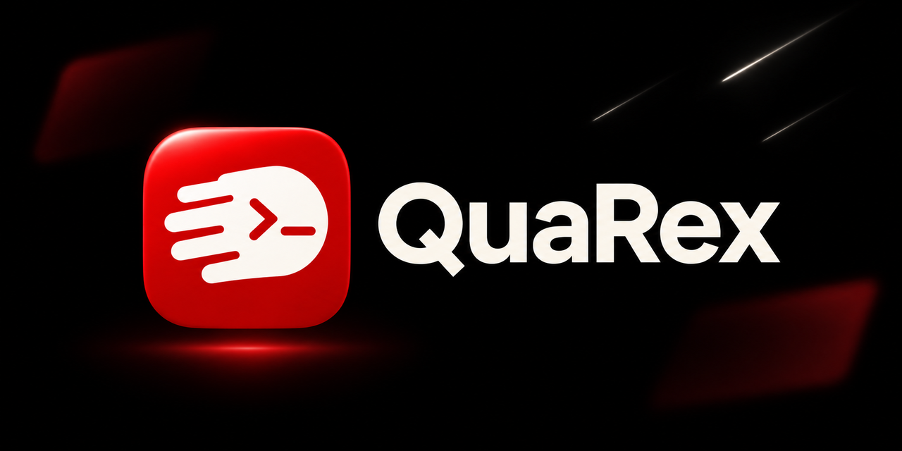
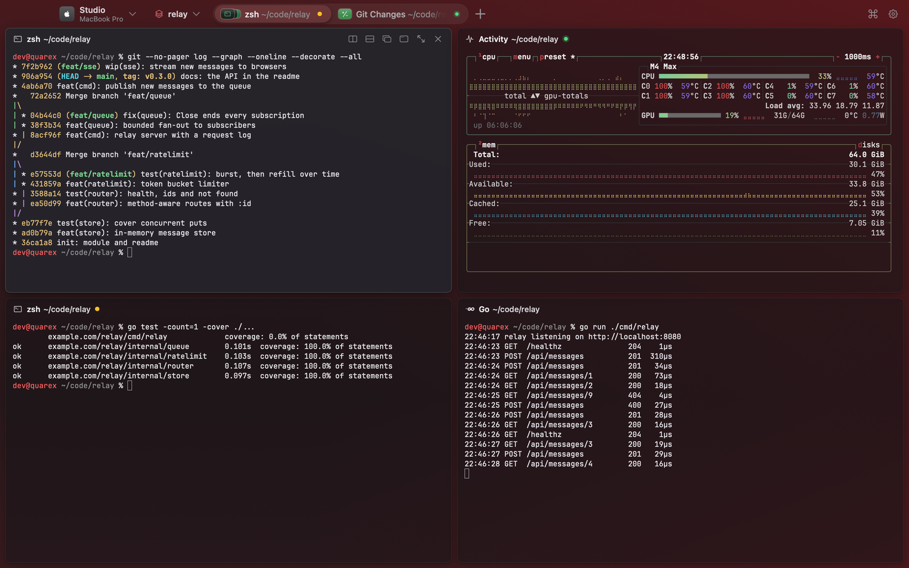
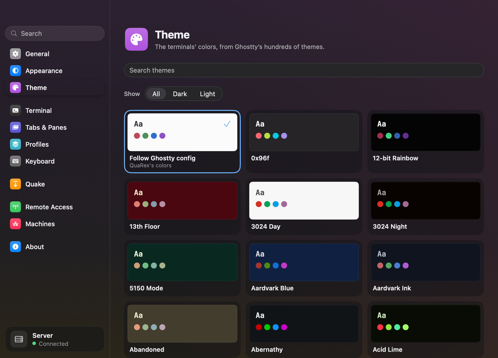

<p align="center">
    
</p>

<!-- BEGIN abd3lraouf-studios:hero -->
<h1 align="center">QuaRex — the drop-down terminal for macOS, Windows and Linux</h1>

<p align="center">
    <strong>A terminal that drops from the top of the screen at one key, with tabs, splits and sessions on every machine you use.</strong><br>
    macOS 13+ · Windows 10+ · Linux · Free preview
</p>

<p align="center">
    <a href="https://github.com/abd3lraouf-studios/quarex/releases/latest"><strong>Download — macOS, Windows, Linux →</strong></a>
</p>

<p align="center">
    <a href="https://abd3lraouf.dev/projects/quarex/">abd3lraouf.dev/projects/quarex/</a>
</p>
<!-- END abd3lraouf-studios:hero -->

<p align="center"><strong>Quake + Rex = QuaRex</strong></p>

QuaRex is a terminal that drops down from the top of the screen when you
press a key, as **Quake**'s console did, and keeps spaces of tabs and split
panes running on this computer and the others you connect, as **Rex** does.
Quit it and nothing stops: open it again and every tab, split and program
is where you left it.

<p align="center">
    
</p>

It is written in Go, with [MyGo](https://github.com/egoist/mygo)'s native UI
and Ghostty's terminal core. This repository holds its releases, the feed
the app updates itself from, its guide and its changelog.

## What it does

- **A quake terminal.** Press F12 — or any key you choose — in any app, and
  a terminal drops from the top of the screen, over full-screen apps too, on
  the screen the pointer is on. Press it again, or click elsewhere, and it
  goes back up. It keeps a space of its own, a pin holds it down while you
  switch apps, and its height runs from 20% of the screen to all of it.
- **Spaces, tabs and split panes.** Name a space and give it a colour; each
  window shows one. Split, zoom and resize panes, drag a pane or a tab to
  another window or out into a window of its own, with its program still
  running. Terminals opened in one folder, side by side, gather under a bar
  of that folder's name, path and Git branch.
- **Every machine in one window.** New Tab and Split ask where the pane
  runs: this computer, a computer running QuaRex that you paired once, or an
  SSH host — which opens on the local network where it answers and over
  Tailscale where it does not. One tab can hold panes of several machines.
- **Sessions that outlive the window.** Shells keep running when QuaRex
  quits, and full-screen programs such as vim and htop come back exactly.
- **From any pane, here.** Command-click a file printed in another
  machine's pane and it opens on this one — in Quick Look on a Mac. A
  `localhost` link from a dev server there opens in your browser here.
- **A terminal the way iTerm2 users expect.** A right-click menu for links,
  selections and commands; shell integration for zsh, bash and PowerShell
  (copy a command or its output, run it again, jump between prompts); Copy
  Mode, annotations and snippets; focus follows the mouse.
- **More than terminals.** Browser panes, note panes that render Markdown,
  Kitty graphics, a command palette, every Ghostty theme, and JetBrains Mono
  with Nerd Font icons built in.
- **Scriptable, and ready for agents.** A Rex `init.lua` configures keys and
  actions; `quarex do` scripts the running app; `quarex skill setup` teaches
  Claude Code, Codex, OpenCode and Pi to drive QuaRex from the command line.

<p align="center">
    
</p>

Every key, setting and remote-access option is in the
**[guide](docs/guide.md)**; the command line in [docs/cli.md](docs/cli.md),
Lua in [docs/lua.md](docs/lua.md).

## Install

Download the file for your system from the
**[latest release](https://github.com/abd3lraouf-studios/quarex/releases/latest)**,
or use the one-line installer.

| System | Runs on | File | Notes |
|---|---|---|---|
| **macOS** | macOS 13 or later, Apple silicon | `quarex-<version>-arm64.dmg` | Signed and notarized by Apple. Open the disk image and drag QuaRex to Applications. |
| **Windows** | Windows 10 (1809) or later, x64 or ARM64 | `quarex-setup-<version>-amd64.exe`, `-arm64.exe` | A setup wizard that asks where: for all users in `C:\Program Files\QuaRex` (with an administrator's prompt, as its updates then ask too), or for you alone in `%LOCALAPPDATA%\Programs\QuaRex`. Remove it in Settings › Apps. **Not code-signed yet**, so SmartScreen warns — see below. |
| **Linux** | x64 or ARM64 | `quarex_<version>_amd64.deb`, `_arm64.deb`, or `quarex-<version>-linux-<arch>.tar.gz` | The `.deb` for Debian and Ubuntu; the tarball installs for you alone, in `~/.local`, on any distribution. |

### One-line install

macOS or Linux:

```sh
curl -fsSL https://github.com/abd3lraouf-studios/quarex/releases/latest/download/install.sh | sh
```

On a Mac the script installs the newest version in `/Applications` (or
`~/Applications` when it cannot write there) after checking its signature.
On Linux it installs for your user only — the app in `~/.local`, the
`quarex` command in `~/.local/bin` and an entry in the applications menu —
with no root. `sh install.sh --uninstall` removes it and leaves your
settings in place.

Windows, in PowerShell:

```powershell
irm https://github.com/abd3lraouf-studios/quarex/releases/latest/download/install.ps1 | iex
```

The script picks the installer for your PC (x64 or ARM64), checks it
against the release's `SHA256SUMS` and installs it silently, for you
alone. An install of 0.1.5 or before, a Windows Installer package, is
replaced in its folder.

### "Windows protected your PC"

The Windows installer is not code-signed yet, so Microsoft Defender
SmartScreen stops it the first time. Choose **More info**, then
**Run anyway**. To check the file first, compare its SHA-256 with its line
in the release's `SHA256SUMS`:

```powershell
Get-FileHash .\quarex-setup-<version>-amd64.exe
```

### Checksums

Every release carries `SHA256SUMS`, the SHA-256 of every file in it:

```sh
shasum -a 256 -c SHA256SUMS --ignore-missing
```

## Updates

QuaRex updates itself from this repository's releases. Updates are signed
with an Ed25519 key that only the maintainer holds, and the app installs
only an update carrying that signature. It checks once a day, and
**Check for Updates…** checks now — in the app menu on macOS, the Shell
menu on Windows and Linux, and the command palette. On Linux, the per-user
install also updates from a terminal with `quarex update`. What each
version changed is in [CHANGELOG.md](CHANGELOG.md) and on its
[release](https://github.com/abd3lraouf-studios/quarex/releases).

Installs of 0.1.4 and earlier read their updates from a repository that is
gone: install the latest release over them, which keeps your settings.

## On iPhone and iPad

QuaRex for iPhone and iPad puts the terminals of your computers in your
pocket — a Ghostty terminal with a key bar made for touch, notifications
when an agent is waiting for you, photos and files sent straight to the
host, and files and `localhost` links from a session that open in the app.
It is in **internal testing on TestFlight**, not on the App Store yet.

## Coming from GoRex

QuaRex keeps its state in `QuaRex` in your configuration directory
(`QUAREX_DIR` to choose another), and takes GoRex's settings, keys and
remote access from GoRex's the first time it runs. GoRex's names still
work: every `QUAREX_*` environment variable is read under its `GOREX_*`
name too, and the command is `quarex`, with `gorex` beside it in every
QuaRex terminal.


## Reporting issues

Bugs and ideas are welcome as [issues](https://github.com/abd3lraouf-studios/quarex/issues),
or through the studio's contact form at
[abd3lraouf.dev/#contact](https://abd3lraouf.dev/#contact). Report a security
problem privately, through the contact form or
[GitHub's private vulnerability reporting](https://github.com/abd3lraouf-studios/quarex/security/advisories/new),
not in a public issue.

QuaRex is closed source (see [License](#license)), so this repository takes
issues, not pull requests.

## Credits

QuaRex stands on the work of others:

- **[GoRex](https://github.com/si-mods/gorex)** (and
  [egoist/gorex](https://github.com/egoist/gorex) before it), by Undefined K,
  EGOIST and windzu, a Go replica of Rex: QuaRex began from GoRex 0.18.0,
  credited to its authors. GoRex has no license, so the parts of QuaRex that
  come from it remain its authors'.
- **Rex**, by Superlogical, whose spaces of tabs and panes across machines
  GoRex replicates: QuaRex reads a Rex `init.lua`, serves Rex's API to Rex's
  clients, and imports a Rex session.
- **Quake**, by id Software, whose drop-down console gave QuaRex its first
  half and its name.
- **[MyGo](https://github.com/egoist/mygo)**, by EGOIST, MIT License: the UI,
  the build and the updates.
- **[Ghostty](https://ghostty.org)**'s libghostty-vt, MIT License: the
  terminal emulation, through MyGo's terminal plugin; its themes come from
  [iTerm2-Color-Schemes](https://github.com/mbadolato/iTerm2-Color-Schemes),
  MIT License.
- **[iTerm2](https://iterm2.com)**, whose menus, shell integration and word
  selection QuaRex follows.
- **[Font Awesome Pro](https://fontawesome.com)** icons, under the
  maintainer's commercial license.
- **[JetBrains Mono](https://www.jetbrains.com/lp/mono/)** (SIL Open Font
  License 1.1), **[Symbols Nerd Font](https://www.nerdfonts.com)** (MIT; its
  icon sets' licenses with it) and **[Simple Icons](https://simpleicons.org)**
  brand marks (CC0 1.0).
- **rootshell**, which QuaRex drives through a `herdr` shim.

Each component's terms are in [NOTICE.md](NOTICE.md).


## License

QuaRex is **closed source**, and **free to download and use**. The apps on
the [releases](https://github.com/abd3lraouf-studios/quarex/releases) may be
installed, used and shared unmodified, free of charge ([LICENSE](LICENSE)).
The parts that come from GoRex remain their authors', and third-party
components keep their own licenses ([NOTICE.md](NOTICE.md)).

<!-- BEGIN abd3lraouf-studios:press -->
## Press & marketing assets

QuaRex is a terminal for macOS, Windows and Linux that drops down from the top of the screen at a key, as Quake's console did, and holds spaces of tabs and split panes across this machine and others — over SSH, Tailscale or a paired QuaRex — with sessions that keep running after the window closes.

**Naming.** Written "QuaRex" — one word, capital Q and capital R, from Quake and Rex. Never "Quarex", "QuaREX" or "Qua Rex". The command it installs is lowercase: `quarex`.

The press kit — icons, screen art, boilerplate, the fact sheet and a downloadable
archive — is at **[abd3lraouf.dev/press/quarex/](https://abd3lraouf.dev/press/quarex/)**.
<!-- END abd3lraouf-studios:press -->
